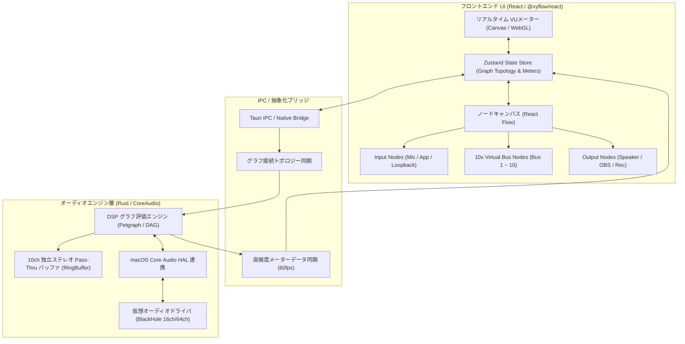

# AudioNodeRouter アーキテクチャ設計書

macOS上で動作する、10系統以上の独立した仮想オーディオラインを視覚的に管理・ルーティングできる「ノードベース・オーディオミキサー／ルーティングシステム」の設計仕様です。

---

## 1. 全体アーキテクチャ概要

---

## 2. 10系統 仮想オーディオバス（Pass-Thru Bus）の仕様

### 2.1 独立ステレオバス（Bus 1 ~ Bus 10）
各バスは完全独立したステレオチャンネル（L/R）として機能し、以下のパラメータを持ちます：
- **Volume / Gain**: $-60\,\text{dB} \sim +12\,\text{dB}$ （標準 $0\,\text{dB}$）
- **Mute**: 音声出力を即座にカット（ソフトフェード処理でプチノイズ防止）
- **Solo**: 指定したバス以外の出力を一時的にミュート
- **Pan**: ステレオ定位の調整（$-100 \sim +100$）
- **Stereo VU Meter**: Peak / RMS のリアルタイム計測（L/R独立）
- **Buffer Pool**: レイテンシ最小化のための Lock-free RingBuffer（512 サンプル / 48kHz）

### 2.2 BlackHole 仮想ドライバとのマッピング対応
macOSで最も安定して普及している仮想オーディオドライバ「BlackHole 16ch / 64ch」とマッピング可能です：

| Bus 系統 | BlackHole チャンネル (16ch / 64ch) | 物理/仮想用途の例 |
| :--- | :--- | :--- |
| **Bus 1** | Channel 1-2 (Stereo) | 通話音声（Discord / Zoom） |
| **Bus 2** | Channel 3-4 (Stereo) | ゲーム音声 / ブラウザ音声 |
| **Bus 3** | Channel 5-6 (Stereo) | BGM / 音楽プレイヤー |
| **Bus 4** | Channel 7-8 (Stereo) | SE / サウンドエフェクト |
| **Bus 5** | Channel 9-10 (Stereo) | マイク（入力補正前/クリーン） |
| **Bus 6** | Channel 11-12 (Stereo) | マイク（ボイスチェンジャー/FX後） |
| **Bus 7** | Channel 13-14 (Stereo) | 配信プレビュー（OBSモニター） |
| **Bus 8** | Channel 15-16 (Stereo) | システム通知音 |
| **Bus 9** | Channel 17-18 (64ch使用時) | 予備系統 A (DAW等) |
| **Bus 10** | Channel 19-20 (64ch使用時) | 予備系統 B (録音専用バス) |

---

## 3. UI/UX 設計（ノードシステム）

BlenderやComfyUIのような快適で直感的な操作感を実現します：
1. **ワイヤー（ケーブル）ルーティング**:
   - 出力ピン（右側・緑色）をクリック＆ドラッグし、入力ピン（左側・青色）に接続。
   - 1つの出力を複数の入力に分岐接続（マルチプルルーティング）可能。
   - 複数の入力を1つの入力ピンで自動加算ミキシング（Summing）。
2. **チャンネルストリップ統合ノード**:
   - 各ノード内部にスライダー、ミュートボタン、ソロボタン、VUメーター（LEDバー表示）を内蔵。
3. **ノード検索・追加パレット**:
   - キャンバス上で右クリック、または「ノード追加」ボタンでクイック追加。

---

## 4. エフェクト拡張パイプライン（将来対応）

ノード間にエフェクトノード（Filter / 3-Band EQ / Compressor / Limiter / Reverb 等）を挟むことで、音質補正やダイナミクス制御をビジュアルに組める設計を採用。
ノードグラフは有向非巡回グラフ（DAG: Directed Acyclic Graph）としてトポロジカルソートされ、オーディオ処理スレッドで超低レイテンシで処理されます。
